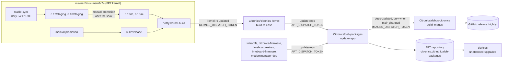

# Citronics build and release process

How code becomes packages in the Citronics APT repository and images people
flash, how kernels move from a stable update to the devices, and what to do
by hand. Scope: the Fairphone 2 (FP2, armhf) and Fairphone 3 (FP3, arm64)
Lime images.

## Overview



Every hop runs on its own. Each one can also be started by hand (see
[Manual triggers](#manual-triggers)).

## Repositories

| Repository | Produces | Built when |
|---|---|---|
| [mlainez/linux-msm8x74](https://github.com/mlainez/linux-msm8x74) | FP2 kernel source: `6.12/*` and `6.18/*` branches | stable merges (stable-sync), topic merges, promotions |
| [Citronics/citronics-kernel](https://github.com/Citronics/citronics-kernel) | kernel `.deb`s as GitHub releases, `components.tsv` | a kernel branch in `kernels.conf` moves; push to `configs/`, `kernels.conf` or the build scripts; by hand |
| [Citronics/deb-packages](https://github.com/Citronics/deb-packages) | the APT repository (branch `gh-pages`), the meta-packages in `meta-packages/` | a publisher asks for it; daily at 05:17 UTC; by hand |
| [Citronics/debos-citronics](https://github.com/Citronics/debos-citronics) | the six images (`debian`, `ubuntu`, `raspap` × `fp2`, `fp3`) | `main` of the APT repository changed; RaspAP upgrade (raspap-sync, daily 04:41 UTC); `v*` tag; by hand |
| [Citronics/initramfs](https://github.com/Citronics/initramfs) | `citronics-initramfs` | push to `main` touching `initramfs/`, `build.sh`, `release.sh` |
| [Citronics/citronics-firmware](https://github.com/Citronics/citronics-firmware) | `linux-firmware-lime-fp2`, `linux-firmware-lime-fp3` | push to `master` touching the firmware or build scripts |
| [Citronics/limeboard-extras](https://github.com/Citronics/limeboard-extras) | `limeboard-io`, `limeboard-ha`, the GPIO Python libraries | push to `main`; new upstream releases (upstream-sync, daily) |
| [Citronics/limeboard-firmware](https://github.com/Citronics/limeboard-firmware) | `limeboard-io-firmware` | push to `main` |
| [Citronics/modemmanager-deb](https://github.com/Citronics/modemmanager-deb) | the patched ModemManager, in the `trixie` and `resolute` suites | push to `main`; new Debian/Ubuntu ModemManager versions (daily check) |
| [Citronics/unudhcpd-deb](https://github.com/Citronics/unudhcpd-deb) | `unudhcpd` | by hand (`build.sh`, `release.sh`) |
| [Citronics/limeboard-extras](https://github.com/Citronics/limeboard-extras) | `limeboard-io`, `limeboard-ha`, Python GPIO libraries | push to `main` touching the packages; upstream-sync (daily 04:17 UTC) for the PyPI libraries |
| [Citronics/limeboard-firmware](https://github.com/Citronics/limeboard-firmware) | `limeboard-io-firmware` | push to `main` touching the firmware sources |
| [Citronics/u-boot](https://github.com/Citronics/u-boot) | U-Boot for FP2 and FP3 as GitHub releases `citronics-*` | push to `main`; flashed by hand, not part of the APT repository or the images |

## Kernel

### Branches (FP2)

The fork's branch scheme (see its `AGENTS.md`):

```
<kver>/topic/<feature>  ->  <kver>/staging  ->  <kver>/rc  ->  <kver>/release
```

Only two series exist for the FP2: **6.12**, the production series, and
**6.18**, LTS-tracking work. Both are LTS kernels.

| Branch | Moves when | Built as |
|---|---|---|
| `6.12/rc` | **only** by manual promotion of a soaked staging | rc kernel, APT `experimental` |
| `6.12/release` | **only** by manual promotion of a validated rc | release kernel, APT `main` |
| `6.18/rc` | **only** by manual promotion of a soaked staging | rc kernel, APT `experimental` |
| `*/baseline`, `*/staging` | stable-sync, topic merges | not built |

### stable-sync

`.github/workflows/stable-sync.yml` on the fork's default branch
(`6.18/staging`) runs daily at 04:17 UTC. It merges `linux-6.12.y` into
`6.12/{baseline,staging}` and `linux-6.18.y` into `6.18/{baseline,staging}`,
one branch at a time:

- it fetches from git.kernel.org, or from github.com/gregkh/linux when
  git.kernel.org is unreachable, and merges only a stable release whose tag is
  signed by the stable release key and points at the fetched commit;
- a clean merge is pushed; a stable update reaches `rc`, and becomes an rc
  kernel, only when a staging that carries it is promoted after the on-device
  soak (the fork's AGENTS.md section 1.1);
- a conflict fails that branch's job with the conflicting files in the error,
  leaves the branch untouched, and the other branches still sync. Resolve it
  by merging stable into the branch by hand, push, done;
- it **never touches an rc or release branch**.

### Channels

`kernels.conf` in citronics-kernel lists what is built:

```
fp2  msm8x74-6.12     .../linux-msm8x74   6.12/release   arm   main   meta
fp2  msm8x74-6.12-rc  .../linux-msm8x74   6.12/rc        arm   rc
fp2  msm8x74-6.18-rc  .../linux-msm8x74   6.18/rc        arm   rc
```

| | rc | release |
|---|---|---|
| Kernel release | `6.12.118-citronics-lime-fp2-rc` | `6.12.117-citronics-lime-fp2` |
| APT component | `experimental` | `main` |
| Meta-package `linux-image-citronics-lime-fp2` | no | yes: devices follow it |
| GitHub release | prerelease (when it contains no release kernel) | release |

The rc and release kernels of the same version have different package names,
so both can be installed side by side.

Each citronics-kernel build rebuilds whichever kernels moved since the last
build (source commit or config, recorded in `build-state.tsv`), tags the
build `vX.Y.N` and lists each package's APT component in the release's
`components.tsv`.

Package versions come from the tags: `3.2~rc3.23 < 3.2 < 3.2.1 < 3.2.2`.
Builds number themselves after the latest human tag (`v3.2` → `v3.2.1`,
`v3.2.2`, …). Cut a new human tag (`git tag -a v3.3 -m ...` on a commit other
than master's head) to start a new series.

FP3: no kernel is built by CI yet. Its kernel in the APT repository was
published by hand; the FP3 lines in `kernels.conf` are commented out until
its pipeline exists.

### Promoting an rc to release (manual)

Promotion is a deliberate human step. The rc must pass on a device first,
following the fork's promotion gate (`AGENTS.md` §1.1).

1. **Install the rc kernel on a test device** (see
   [Trying an rc kernel](#trying-an-rc-kernel-on-a-device)) and reboot into it.
2. **Functional check**: `uname -r` shows the `-rc` kernel; no failed units
   (`systemctl --failed`); remoteprocs running
   (`cat /sys/class/remoteproc/*/state`); QRTR services present
   (`qrtr-lookup`); Wi-Fi up; IIO sensors present; DLN-2 (`lsmod | grep dln2`)
   on Limeboard devices; cpufreq driver `cpufreq-dt` on all cores; no
   `Oops`, `BUG:` or `WARNING:` in `dmesg`.
3. **Soak**: at least 60 minutes with DVFS active, logging uptime, CPU
   frequencies, temperatures and remoteproc state every 30 seconds to a
   synced file on the device. The boot ID must not change; the log must have
   no gaps. This SoC resets silently, so a short boot that looks fine is not
   evidence.
4. **Promote** in the kernel fork. If `6.12/release` is an ancestor of the
   validated commit:

   ```sh
   git push origin <validated-sha>:refs/heads/6.12/release
   ```

   Otherwise create a merge commit whose tree is exactly the validated one, so
   that the release is the tested kernel and nothing is rewritten:

   ```sh
   git fetch origin
   M=$(git commit-tree "<validated-sha>^{tree}" -p origin/6.12/release -p <validated-sha> \
         -m "Merge 6.12/rc (Linux 6.12.x) into 6.12/release")
   git push origin "$M:refs/heads/6.12/release"
   ```

5. The push triggers the chain: notify-kernel-build → citronics-kernel builds
   the release kernel and its meta-package → deb-packages publishes them in
   `main` → debos-citronics rebuilds the images. Devices pick the release up
   through `unattended-upgrades` within a day.
6. Check on a device that a plain `sudo apt update && sudo apt full-upgrade`
   installs the new `linux-image-citronics-lime-fp2` and boots it.

## APT repository

`https://citronics.github.io/deb-packages`, suite `stable`, components:

- `main`: what devices install. Release kernels, meta-packages, firmware,
  initramfs, Limeboard tools.
- `experimental`: rc kernels (and FP3 experimental kernels). Devices only see
  it if they opt in.

Packages built for one distribution release, whose versions differ per
release, go to a suite named after its codename (`trixie`, `resolute`),
component `main`: in `stable`, apt would pick the highest version whatever
distribution it was built for. Today these are the patched ModemManager
builds of [modemmanager-deb](https://github.com/Citronics/modemmanager-deb).
Images list `Suites: stable <codename>`; the `citronics-lime-*`
meta-packages (FP2 2.7, FP3 1.6) add a `citronics-<codename>.sources` on
older installations that lack the suite.

The repository is not signed; devices trust it with `Trusted: yes`.

### update-repo

`.github/workflows/update-repo.yml` rebuilds the whole index on every run:

1. downloads the `.deb` assets of every release of the publisher repositories
   (the `REPOS` list in the workflow). Kernel packages already in the pool,
   or listed in `pruned.txt`, are not downloaded again;
2. drops FP2 kernels of any series other than 6.12 and 6.18;
3. places each package in `main` or `experimental` according to its
   release's `components.tsv`; kernels from releases older than the manifest
   use a fallback list in the workflow. A package listed in its release's
   `suites.tsv` goes to `pool/<codename>` instead, which holds exactly the
   files the current releases list;
4. **prunes experimental kernels**: per series (image or headers, kernel
   major.minor, phone) only the packages of the 3 newest citronics-kernel
   releases stay, older ones are deleted and recorded in `pruned.txt`
   (`scripts/prune-experimental.sh`). A package whose release was deleted
   counts as the oldest of its series. Release kernels in `main` are never
   pruned. This keeps the GitHub Pages site under its 1 GB limit;
5. builds the meta-packages in `meta-packages/`. **A meta-package version
   that is already published is never rebuilt**: to change a meta-package,
   bump its `Version:` in `DEBIAN/control`;
6. generates the index, commits it to `gh-pages`;
7. asks debos-citronics to rebuild the images **only if a `main` index
   changed** (of `stable` or of a codename suite). A change that only touches `experimental` does not rebuild
   them.

A failed release listing or a refused image-build request fails the run.

## Images

`build-images.yml` in debos-citronics builds the six images and publishes
them as:

- the `nightly` prerelease, for runs started by deb-packages, raspap-sync or
  by hand (it replaces the previous nightly);
- a release named after the tag, for a pushed `v*` tag.

## Tokens

Cross-repository requests need a token; GitHub's own `GITHUB_TOKEN` only
works inside its repository. One fine-grained personal access token is stored
under three names:

| Secret | Stored in | Lets it request |
|---|---|---|
| `KERNEL_DISPATCH_TOKEN` | `mlainez/linux-msm8x74` | a build in `Citronics/citronics-kernel` |
| `APT_DISPATCH_TOKEN` | `Citronics/citronics-kernel`, `initramfs`, `citronics-firmware`, `limeboard-extras`, `limeboard-firmware`, `modemmanager-deb` | an index update in `Citronics/deb-packages` |
| `IMAGES_DISPATCH_TOKEN` | `Citronics/deb-packages` | an image build in `Citronics/debos-citronics` |

The token: resource owner **Citronics**; repositories `citronics-kernel`,
`deb-packages`, `debos-citronics`; permission **Contents: Read and write**.
Fine-grained tokens for an organisation need an organisation owner's approval
(Citronics → Settings → Personal access tokens → Pending requests).

**The token expires.** When it does, the cross-repository hops fail (the runs
turn red). To rotate it, create a new token with the same settings, have it
approved, and store it in all eight places. This works in bash and zsh and
stops if the token was not captured:

```sh
printf 'Token: '; stty -echo; read -r T; stty echo; echo
[ ${#T} -gt 30 ] && echo "length ok (${#T})" || echo "EMPTY/short, stop"
printf '%s' "$T" | gh secret set KERNEL_DISPATCH_TOKEN --repo mlainez/linux-msm8x74
for r in citronics-kernel initramfs citronics-firmware limeboard-extras limeboard-firmware modemmanager-deb; do
  printf '%s' "$T" | gh secret set APT_DISPATCH_TOKEN --repo Citronics/$r
done
printf '%s' "$T" | gh secret set IMAGES_DISPATCH_TOKEN --repo Citronics/deb-packages
unset T
```

## Devices

Images configure `/etc/apt/sources.list.d/citronics.sources`:

```
Types: deb
URIs: https://citronics.github.io/deb-packages
Suites: stable
Components: main
Trusted: yes
```

`unattended-upgrades` installs updates from it daily, so a release reaches
devices without anyone logging in.

The kernel that boots is the one on the boot partition (`/boot/zImage` on the
FP2, `/boot/Image.gz` on the FP3, with `/boot/initramfs.gz`). The kernel hook
of `citronics-initramfs` (`/etc/kernel/postinst.d/zz-citronics-boot`) puts
there the kernel package that was installed or configured last, after
validating its initramfs.

### Trying an rc kernel on a device

```sh
sudo sed -i 's/^Components: main$/Components: main experimental/' /etc/apt/sources.list.d/citronics.sources
sudo apt update
apt list 'linux-image-*-rc' 2>/dev/null
sudo apt install linux-image-6.12.118-citronics-lime-fp2-rc
sudo reboot
```

Back to the release kernel: reinstall it, which puts it back on the boot
partition, then reboot. Optionally remove the rc kernel and the
`experimental` component again:

```sh
sudo apt install --reinstall "linux-image-$(dpkg-query -W -f='${Depends}' linux-image-citronics-lime-fp2 | sed -E 's/^linux-image-([^ ]+).*/\1/')"
sudo reboot
sudo apt remove linux-image-6.12.118-citronics-lime-fp2-rc
```

## Manual triggers

| To | Run |
|---|---|
| merge stable updates now | `gh workflow run stable-sync.yml --repo mlainez/linux-msm8x74 --ref 6.18/staging` |
| build kernels now | `gh workflow run build-release.yml --repo Citronics/citronics-kernel --ref master` |
| refresh the APT repository | `gh workflow run update-repo.yml --repo Citronics/deb-packages --ref main` |
| rebuild the images | `gh workflow run build-images.yml --repo Citronics/debos-citronics --ref main` |

A kernel build without moved branches does nothing ("Nothing changed").
Re-running a failed run (`gh run rerun <id> --failed`) uses the current
secrets.

## Known limitations

- The APT repository is unsigned (`Trusted: yes`).
- The FP3 kernel is not built by CI.
- Only the `nightly` image release exists; no `v*` image release has been cut.
- The dispatch token is a personal access token and expires.
